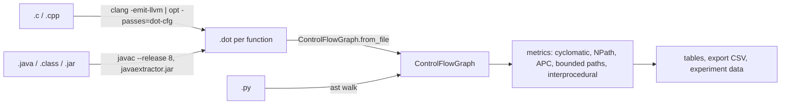

# Metrinome development guide

This guide is for people changing Metrinome. To use it, see the [user guide](user-guide.md).

- [Setting up](#setting-up)
- [Repository layout](#repository-layout)
- [How Metrinome works](#how-metrinome-works)
- [Extending Metrinome](#extending-metrinome)
- [Tests](#tests)
- [Continuous integration](#continuous-integration)
- [Code style and commits](#code-style-and-commits)
- [Rules that keep published results reproducible](#rules-that-keep-published-results-reproducible)
- [Known issues](#known-issues)

## Setting up

Development happens natively; Docker is optional.

```bash
git clone https://github.com/YukiYang31/metrinome.git && cd metrinome
python3 -m venv venv && . venv/bin/activate          # venv/ is git-ignored
pip install -r requirements-dev.txt
# clang + LLVM 14 or newer, and a JDK 8 or newer, on PATH (see the user guide for conda-forge without root)
cd src && python3 main.py --debug
```

Run everything from `src/`. Modules import each other as top-level packages (`from core.env import Env`), so
scripts outside `src/` need `PYTHONPATH=src`.

`--debug` prints every external command Metrinome runs and enables `reload`. `reload` re-imports `core/command.py`
and keeps the loaded graphs, so you can try a change to a command without restarting.

| File | Holds |
|---|---|
| `requirements.txt` | runtime dependencies; keep this minimal |
| `requirements-dev.txt` | tests, linters, plotting and analysis libraries, `tabulate` for `klee-stats` |

The Docker images pin a known toolchain:

| Image | Contents |
|---|---|
| `src/Dockerfile` | development image: LLVM 14 for the C front end, OpenJDK 17, KLEE 3.3 built on LLVM 15 |
| `replication/Dockerfile` | copies `src/` in and starts the paper benchmark menu |

Build both from the repository root (`docker build -f src/Dockerfile .`). `cd src && make run` starts a shell in the
development image with `src/` mounted at `/app/code`, so code changes are visible without rebuilding. Rebuild
after changing dependencies.

KLEE is only needed for `src/klee/` and the KLEE commands. Installing it is covered in the
[user guide](user-guide.md#installing-klee).

## Repository layout

| Path | Contents |
|---|---|
| `src/main.py` | REPL entry point: argument parsing, the `cmd.Cmd` wrapper, tab completion |
| `src/core/command.py` | every REPL command (`Command.do_*`), the `Controller` that owns converters and metrics, argument rules (`Options.commands`) |
| `src/core/command_data.py` | `Data`: the objects the REPL holds (graphs, metrics, KLEE objects), with their list/show/export code |
| `src/core/env.py` | `Env`: project paths and discovery of external tools |
| `src/core/log.py` | `Log`: all user-facing output (`v_msg`, `i_msg`, `e_msg`, `d_msg`) |
| `src/lang_to_cfg/` | converters: `cpp.py` (C/C++ via clang and opt), `java.py` (javac and `javaextractor/`), `python.py` (Python AST) |
| `src/graph/` | `Graph` (vertices and edges) and `ControlFlowGraph` (a graph with entry/exit and metadata such as calls) |
| `src/metric/` | one class per metric, all implementing `MetricAbstract` |
| `src/inlining/` | source-level function inlining for `convert -i` / `-h` |
| `src/klee/` | KLEE harness generation (`klee_utils.py`) and the KLEE experiments |
| `src/experiments/` | one directory per published study: programs, scripts, and data |
| `src/analyze/` | curve fitting for KLEE data |
| `src/meta_analysis/` | comparing two metrics across many functions |
| `src/tests/` | unit, regression, and front-end tests; `fixtures/` holds small programs written for tests |
| `src/Benchmark.sh` | the paper benchmark menu |
| `examples/` | git submodule with large example programs and CFGs ([metrinome_data](https://github.com/hmc-alpaqa/metrinome_data)) |

## How Metrinome works



### The REPL

`main.py` builds a `Prompt` (`cmd.Cmd`). For every entry in `Options.commands`, it creates `do_<name>` on `Prompt`.
That wrapper checks the argument count against the command's `CmdInfo`, splits off `-r`, calls
`Command.do_<name>(flags, *args)`, and turns `ToolNotFoundError` into an error message instead of a crash. The
command's docstring becomes its `help` text. `convert` is the exception: it parses its own arguments
(`Command.parse_convert_args`).

`Command` holds a `Controller`, which owns the converters (`graph_generators`, keyed by file extension) and the
metrics (`metrics_generators`, in display order). Results live in `Command.data` (`Data`).

### Env and external tools

All paths and tools go through `core/env.py`; never hardcode either.

- **Paths:** `Env.PROJECT_PATH` is the `src/` directory (or `$METRINOME_HOME`). `TMP_PATH`, `TMP_DOT_PATH`,
  `EXPORT_PATH`, and `KLEE_OUT_PATH` sit under it. `Env.project_file("tests/...")` resolves a path relative to it.
- **Tools:** `Env.clang()`, `Env.opt()`, `Env.java(tool)`, `Env.klee(tool)`, `Env.klee_include()`, `Env.klee_lib()`,
  `Env.klee_clang()`, and `Env.fake_libc_include()` locate their tool on first use and cache the answer. A missing
  tool raises `ToolNotFoundError` with a message naming the override variable.
- **Tests:** they change environment variables, so they call `.cache_clear()` on these functions (see
  `tests/test_frontends.py` and `tests/test_klee.py`).

### C and C++ front end (`lang_to_cfg/cpp.py`)

1. `clang -emit-llvm -S -Xclang -disable-O0-optnone` compiles at `-O0` (or `-O3` for the optimised experiments).
   `LEGACY_C_DIAGNOSTICS` turns clang 16's new errors for old C back into warnings.
2. `opt -passes=dot-cfg` writes `.<function>.dot` files into `Env.TMP_PATH`. With `-O3`, `simplifycfg` runs first.
3. Edges are parsed with `(Node0x[0-9a-f]+)(?::s\d+)?` (switch ports are `:s0`, `:s1`, ...), and each function
   becomes a `ControlFlowGraph` with its calls recorded in the metadata.

The same source gives identical CFGs on LLVM 14 and LLVM 20; this was checked for all 31 ICSE 2021 functions.

### Java front end (`lang_to_cfg/java.py`)

1. `.java` files are compiled with `javac --release 8` on JDK 9+, because the bundled extractor reads Java 8 class files.
2. `java -jar lang_to_cfg/javaextractor/cfg_extractor/javaextractor.jar` writes one `.dot` per method of every
   class file, including nested and anonymous classes (`Outer$1.class`).

### Python front end (`lang_to_cfg/python.py`)

Walks the `ast` directly and builds statement-level CFGs. It supports a subset of the language; see the user guide.

### Metrics

Each metric is a `MetricAbstract` subclass with `name()` and `evaluate(cfg, all_cfgs=[])`:

| Metric | Result |
|---|---|
| Cyclomatic, NPath, bounded paths, lines of code | an `int` |
| Path Complexity | `(APC, closed-form expression)`, with sympy expressions in `n` |
| Interprocedural | `FunctionCallPathComplexity(log).evaluate(cfg, all_cfgs)` returns a dict; the REPL shows its `rfcapc` entry |

`Command.do_metrics` selects metrics by `name()` and by mode (`--recursion`, `--interprocedural`). Export looks
metrics up by name as well. Metric names are therefore part of the interface: renaming one silently breaks
these lookups.

### KLEE (`klee/klee_utils.py`, `Command.do_klee*`)

1. `KleeUtils.show_func_defs` parses the C file with pycparser and writes one harness per function. Preprocessing
   uses gcc with pycparser's fake libc headers and `-D__attribute__(x)=`, because pycparser cannot parse GCC
   attributes; the harness `#include`s the original file by absolute path, so clang still sees the attributes.
2. `klee_to_bc` pipes each harness through `Env.klee_clang()`. KLEE rejects bitcode from a newer LLVM ("Invalid
   record"), which is why this clang can differ from the C front end's clang.
3. `klee <name>` keeps the bitcode and KLEE's output in `Env.KLEE_OUT_PATH/<name>/`, and parses KLEE's summary
   lines into `KleeStat`.
4. `klee_replay` reads the bitcode path from the `.ktest` (`ktest-tool` prints it), links that bitcode with
   `libkleeRuntest`, and runs it with `KTEST_FILE` set.

## Extending Metrinome

### Adding a metric

1. Create `src/metric/<metric>.py` with a `MetricAbstract` subclass. Pick a unique `name()`.
2. Register an instance in `Controller.__init__` (`metrics_generators`). The list order is the display order.
3. In `Command.do_metrics`, decide in which modes it runs (follow the existing `name()` checks) and how to show it.
4. To include it in `export metrics *`, add a column to `Data.export_metrics`.
5. Test the metric directly on small hand-built graphs (see `tests/test_bounded_paths.py`), against values you
   derive by hand.

### Adding a language

1. Implement `ConverterAbstract` in `src/lang_to_cfg/<language>.py`. `to_graph(filename, extension)` receives the
   path without its extension. It returns a dict from graph name to `ControlFlowGraph`, or `None` on failure.
2. Locate any external tool through a new `Env` method, following `Env.java`. Raise `ToolNotFoundError` when it is missing.
3. Register the extensions in `Controller.graph_generators`.
4. Add fixtures and expected metrics to `tests/test_frontends.py`. If the language has a C equivalent, add it to the
   cross-front-end consistency test.

### Adding a REPL command

1. Add `do_<name>(self, flags, ...)` to `Command`, with a docstring that has a `Usage:` section (it is the `help` text).
2. Add `"<name>": CmdInfo(min_args, error_message, recursive_flag_allowed, varargs)` to `Options.commands`.
3. Report problems with `self.logger.e_msg` and return; do not raise. A missing external tool may raise
   `ToolNotFoundError`; the REPL reports it.
4. Document the command in the [user guide](user-guide.md#command-reference).

## Tests

```bash
cd src
python3 -m unittest discover -s tests -t .           # everything, about 2 minutes
python3 -m unittest tests.test_klee -v               # one module
```

| Group | Modules |
|---|---|
| Unit tests | `test_graph`, `test_cfg`, `test_npath`, `test_pathcomplexity`, `test_bounded_paths`, `test_utils`, `test_env`, `test_command`, ... |
| Front ends | `test_cpp`, `test_java`, `test_python`, and `test_frontends`. The last covers switch edges, legacy C, nested Java classes, C/Java agreement on nine constructs, and tool discovery. |
| Published results | `test_published_results` recomputes the ICSE 2021 table (31 functions: cyclomatic, NPath, V, E, APC) and the ISSTA 2024 branching APC (79 functions) and compares them with the CSVs in `src/experiments`. This is the guard against changing published numbers; it takes most of the suite's time. |
| KLEE | `test_klee`: tool discovery and harness generation always run; the end-to-end workflow is skipped when KLEE is not installed |

Conventions:

- **Temporary files:** tests that convert files call `use_private_temp_dirs(self)` (`tests/unit_utils.py`). The
  real temporary directories are shared by every Metrinome process, and tests must never write into the checkout.
- **What a test asserts:** compare with values derived by hand or published, not with whatever the code currently
  outputs. Put new example programs in `tests/fixtures/`.
- **External tools:** tests that need an optional tool skip themselves when it is missing (see `klee_available()`).
  clang and a JDK are required.

## Continuous integration

`.github/workflows/ci.yml` runs on every push and pull request:

| Job | What it does |
|---|---|
| Tests | the whole suite on Ubuntu 22.04 (Python 3.10, LLVM 14) and Ubuntu 24.04 (Python 3.12, LLVM 18) |
| Docker images | builds both images, checks that KLEE works in the development image, and runs the front-end, bounded-path, and KLEE tests inside it |

## Code style and commits

- **Linters:** `make check-lint` in `src/` runs pycodestyle, mypy, pydocstyle, and pylint with the configuration in
  `src/config/`. Much existing code predates them, so keep new code clean rather than fixing unrelated lines.
- **Type hints and docstrings:** every function has type hints and a docstring.
- **Commit messages:** use the `type(scope): summary` form already in the history (`feat`, `fix`, `test`, `ci`,
  `build`, `refactor`, `docs`).
- **Documentation:** keep the README, the user guide, and this guide in step with behaviour changes.

## Rules that keep published results reproducible

- **Metric definitions:** do not change them, or the CFG construction, without a new experiment that justifies
  it. `test_published_results` must keep passing.
- **C front end:** keep it at `-O0` without `simplifycfg`. The old legacy-pass-manager pipeline asked for
  `simplifycfg`, but at `-O0` it never ran (functions were `optnone`). Enabling it now would change 24 of the
  29 ICSE CFGs.
- **Java front end:** keep `--release 8` for javac, because the extractor cannot read newer class files.
- **Library upgrades (pandas, sympy, numpy):** run the full suite. sympy 1.14 prints some APC expressions
  differently (`1.0**n` becomes `1`); the regression test compares values, not strings.

## Known issues

- **C and Java CFGs differ for some constructs** (documented in `tests/test_frontends.py`):
  - an `&&`/`||` loop condition adds a path in C;
  - a ternary with constant arms is branch-free in C;
  - a Java `switch` on a `String` expands into several switches;
  - the Java extractor ignores exception edges.
- **Java graph names** are full paths of the extracted `.dot` files.
- **`convert` options:** only the short forms (`-r`, `-i`, `-h`, `-gs`) work, and only one of them per command.
- **NFS:** on NFS, clearing the temporary directories can print `rm: cannot remove ... Directory not empty`. It is
  harmless: NFS keeps deleted-but-open files around briefly.
- **Path Complexity's closed form** (the second element) drops the constant term of the fitted expression.
- **`klee_experiment.py`** writes its outputs into `src/tests/cFiles/fse_2020_benchmark/`. Set `METRINOME_HOME` to a
  copy of `src/` to keep the checkout clean.
